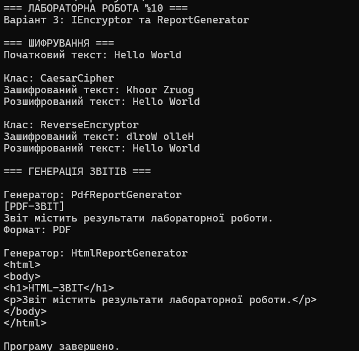

# Лабораторна робота №10

### **Тема:** Абстрактні класи та інтерфейси. Контракти та реалізації.

### Варіант: 3 — Інтерфейс IEncryptor та абстрактний клас ReportGenerator

- **Інтерфейс:** `IEncryptor`.
- **Методи інтерфейсу:** `Encrypt(string data)`, `Decrypt(string encryptedData)`.
- **Реалізації інтерфейсу:** `CaesarCipher`, `ReverseEncryptor`.
- **Абстрактний клас:** `ReportGenerator`.
- **Абстрактні методи:** `CollectData()`, `FormatReport()`.
- **Конкретний метод:** `GenerateOutput()`.
- **Похідні класи:** `PdfReportGenerator`, `HtmlReportGenerator`.

# **Хід роботи:**

### Було встановлено середовище розробки VS Code з усіма необхідними розширеннями: C# Dev Kit; .NET Install Tool.

### Було створено консольний проєкт `lab10v3` у директорії `OOP-Vasilevich`. Відповідно до варіанту було реалізовано інтерфейс **IEncryptor** та абстрактний клас **ReportGenerator**.

Інтерфейс **IEncryptor** визначає контракт для шифрування та розшифрування текстових даних.

Інтерфейс містить два методи: `Encrypt(string data)`, який шифрує текст, та `Decrypt(string encryptedData)`, який розшифровує зашифрований текст.

Було створено клас **CaesarCipher**, який реалізує шифр Цезаря зі зсувом латинських літер на три позиції. Також було створено клас **ReverseEncryptor**, який виконує шифрування шляхом перевертання рядка.

Обидва класи реалізують інтерфейс `IEncryptor`, але використовують різні алгоритми шифрування. Це дозволяє продемонструвати поліморфізм через спільний тип інтерфейсу.

**Абстрактний клас:** `ReportGenerator`, який визначає спільну логіку створення звітів.

Клас містить абстрактні методи `CollectData()` та `FormatReport()`. Метод `CollectData()` відповідає за отримання даних для звіту, а `FormatReport()` — за їх форматування.

Також реалізовано конкретний метод `GenerateOutput()`, який викликає методи збору даних і форматування, після чого виводить сформований звіт у консоль.

Було створено два похідні класи: **PdfReportGenerator** та **HtmlReportGenerator**.

Клас `PdfReportGenerator` перевизначає абстрактні методи та формує демонстраційний звіт у стилі PDF. Клас `HtmlReportGenerator` формує звіт із використанням HTML-тегів.

Для реалізації абстрактних методів у похідних класах використано ключове слово `override`.

У методі **Main()** було створено колекцію об'єктів типу `IEncryptor`, до якої додано екземпляри класів `CaesarCipher` та `ReverseEncryptor`.

Для кожного об'єкта було продемонстровано шифрування та розшифрування тексту. Результати виводяться в консоль.

Також було створено колекцію об'єктів типу `ReportGenerator`, яка містить екземпляри класів `PdfReportGenerator` та `HtmlReportGenerator`.

За допомогою циклу було викликано метод `GenerateOutput()` для кожного об'єкта. Це дозволило продемонструвати поліморфізм і використання спільної логіки абстрактного класу.

У результаті виконання лабораторної роботи було закріплено навички створення інтерфейсів, абстрактних класів, реалізації абстрактних методів, використання `override` та демонстрації поліморфізму в C#.

**Примітка:** генератор `PdfReportGenerator` у цій роботі виводить демонстраційний текст у консоль і не створює справжній PDF-файл.

