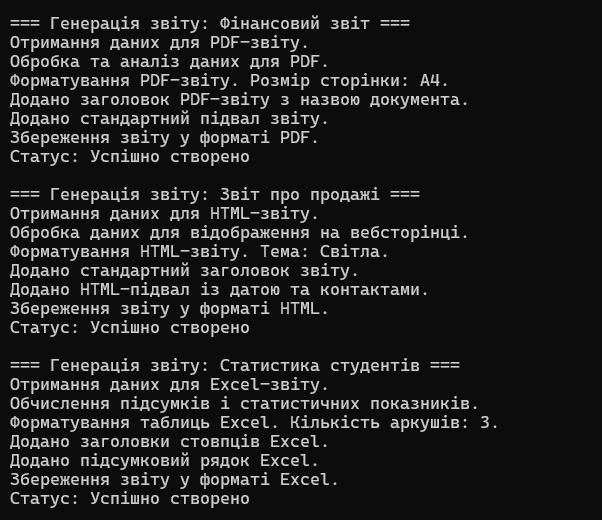

# Лабораторна робота №11

### **Тема:** ReportGenerator: шаблонні кроки й реалізації.

### Варіант: 3 — Клас ReportGenerator

- **Базовий клас:** `ReportGenerator`.
- **Шаблонний метод:** `Generate()`.
- **Кроки:** `FetchData()`, `ProcessData()`, `FormatReport()`, `AddHeader()`, `AddFooter()`, `Save()`.
- **Похідні класи:** `PDFReport`, `HTMLReport`, `ExcelReport`.
- **Властивості:** `ReportName`, `Status`.
- **Абстрактні методи:** `FetchData()`, `ProcessData()`, `FormatReport()`, `Save()`.
- **Віртуальні методи:** `AddHeader()`, `AddFooter()`.

# **Хід роботи:**

### Було встановлене середовище розробки VS Code з усіма необхідними розширеннями: C# Dev Kit; .NET Install Tool.

### Було створено консольний проєкт `lab11v3` у директорії `OOP-Vasilevich`. Відповідно до варіанту створив абстрактний клас **ReportGenerator**.

Клас містить: **Властивості:** `ReportName` для зберігання назви звіту та `Status` для збереження стану генерації.

**Шаблонний метод:** `Generate()` визначає загальну послідовність створення звіту. Він викликає шість кроків: отримання даних, обробку даних, форматування звіту, додавання заголовка, додавання нижнього колонтитула та збереження результату.

**Абстрактні методи:** `FetchData()`, `ProcessData()`, `FormatReport()` та `Save()` визначають обов'язкові кроки генерації звіту, які реалізуються в похідних класах.

**Віртуальні методи:** `AddHeader()` та `AddFooter()` містять стандартну реалізацію додавання заголовка й нижнього колонтитула. За потреби похідні класи можуть перевизначати ці методи відповідно до формату звіту.

Було створено три похідні класи: **PDFReport**, **HTMLReport** та **ExcelReport**.

Клас **PDFReport** відповідає за генерацію звітів у форматі PDF. Він реалізує отримання й обробку даних, форматування документа з урахуванням розміру сторінки, додавання власного заголовка та збереження результату.

Клас **HTMLReport** відповідає за генерацію звітів у форматі HTML. Він реалізує обробку даних для відображення на вебсторінці, форматування з урахуванням обраної теми, додавання власного нижнього колонтитула та збереження звіту.

Клас **ExcelReport** відповідає за генерацію звітів у форматі Excel. Він реалізує отримання даних, обчислення підсумків і статистичних показників, форматування таблиць, додавання заголовків стовпців і підсумкового рядка та збереження результату.

У класі **Program** в методі **Main()** було створено список типу `List<ReportGenerator>`, до якого додано об'єкти класів `PDFReport`, `HTMLReport` та `ExcelReport`.

За допомогою циклу `foreach` було викликано метод `Generate()` для кожного об'єкта. Це дозволило продемонструвати роботу шаблонного методу та поліморфізм: загальна послідовність генерації залишається незмінною, але реалізація окремих кроків залежить від типу звіту.

У результаті виконання програми в консолі відображаються всі етапи генерації PDF-, HTML- та Excel-звітів, а також статус завершення обробки кожного звіту.

