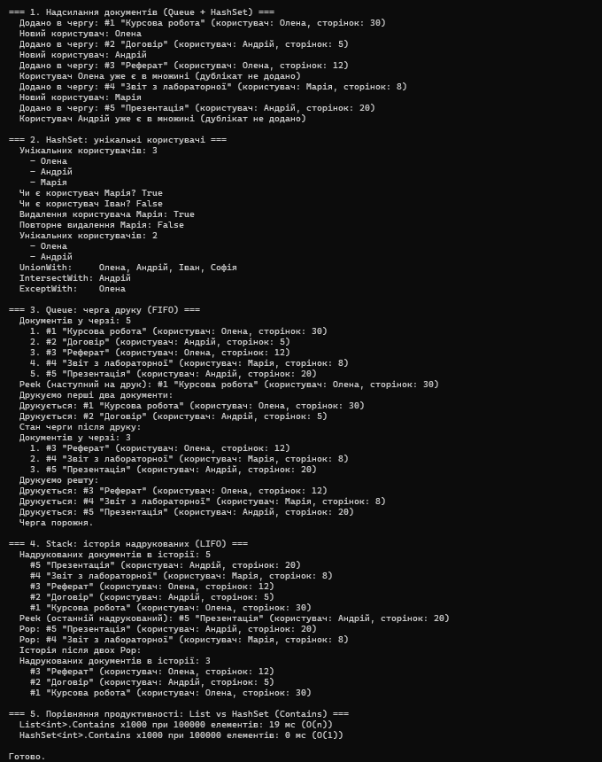

# Лабораторна робота №14, варіант 3: Система друку документів

**Тема:** HashSet / Queue / Stack: практичні сценарії.
**Проєкт:** `lab14v3` (консольний застосунок, .NET).

## Опис

Програма моделює систему друку документів. Клас `Document` описує документ (Id, назва, користувач, кількість сторінок), клас `PrintSystem` містить три колекції, кожна з яких відповідає за свою підзадачу.

## Колекції

| Колекція | Підзадача | Принцип | Продемонстровані операції |
|---|---|---|---|
| `HashSet<string>` | Унікальні користувачі, що надіслали документи | Унікальність елементів | `Add`, `Contains`, `Remove`, `UnionWith`, `IntersectWith`, `ExceptWith`, `Count` |
| `Queue<Document>` | Черга документів на друк | FIFO | `Enqueue`, `Peek`, `Dequeue`, `Count`, перебір |
| `Stack<Document>` | Історія надрукованих документів | LIFO | `Push`, `Peek`, `Pop`, `Count`, перебір |

### HashSet
Коли користувач надсилає документ, його ім'я додається в множину. Якщо користувач уже є (наприклад, Олена надіслала два документи), дублікат не додається, а `Add` повертає `false`.

### Queue
Документи потрапляють у чергу через `Enqueue` і друкуються через `Dequeue` в тому порядку, у якому були надіслані. `Peek` показує наступний документ, не видаляючи його.

### Stack
Після друку документ додається в історію через `Push`. `Peek` показує останній надрукований документ, `Pop` знімає його з вершини. Перебір виводить документи від найновішого до найстарішого.

## Додатково

У кінці `Main` порівнюється швидкість `List<int>.Contains` (O(n)) і `HashSet<int>.Contains` (O(1)) на 100 000 елементів.

## Запуск

```
dotnet run
```

## Приклад виводу
