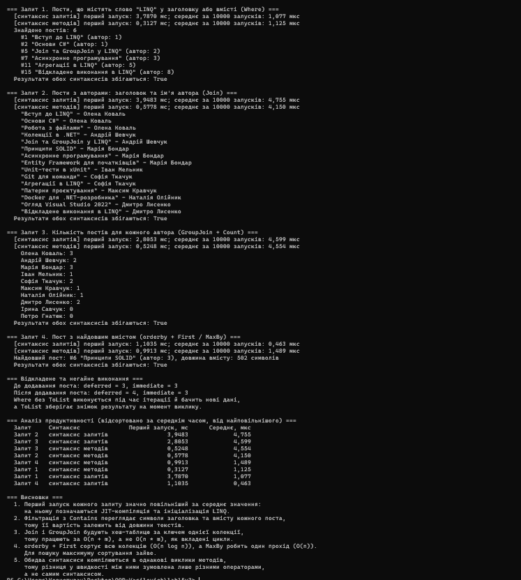

# Лабораторна робота №15, варіант 3: Блог

**Тема:** LINQ в дії: фільтри, join, агрегації. Продуктивність.
**Проєкт:** `lab15v3` (консольний застосунок, .NET 6+).

## Сутності та тестові дані

- `Author` (Id, Name, Email): 10 авторів, двоє з них (Ірина Савчук, Петро Гнатюк) не мають постів.
- `Post` (Id, Title, Content, AuthorId): 15 постів з різною довжиною вмісту.

## Запити

Кожен запит реалізовано і в синтаксисі запитів, і в синтаксисі методів. Результати обох варіантів порівнюються програмою автоматично.

| № | Завдання | Синтаксис запитів | Синтаксис методів |
|---|---|---|---|
| 1 | Пости зі словом «LINQ» у заголовку або вмісті | `from ... where ... select` | `Where` |
| 2 | Заголовок посту та ім'я автора | `from ... join ... on ... equals` | `Join` |
| 3 | Кількість постів для кожного автора | `join ... into` + `Count()` | `GroupJoin` + `Count()` |
| 4 | Пост з найдовшим вмістом | `orderby ... descending` + `First()` | `MaxBy` |

Час вимірюється через `Stopwatch`: перший запуск запиту та середнє значення за 10 000 запусків.

## Запуск

```
dotnet run
```

## Приклад виводу

```
=== Запит 1. Пости, що містять слово "LINQ" у заголовку або вмісті (Where) ===
  [синтаксис запитів] перший запуск: 3,7870 мс; середнє за 10000 запусків: 1,077 мкс
  [синтаксис методів] перший запуск: 0,3127 мс; середнє за 10000 запусків: 1,125 мкс
  Знайдено постів: 6
    #1 "Вступ до LINQ" (автор: 1)
    #2 "Основи C#" (автор: 1)
Ви зупинили відповідь Claude

htlvs

Мабуть, попередня відповідь обірвалась на README. Ось він повністю. Копіюй усе між зовнішніми лапками (рядки з п'ятьма зворотними апострофами в копіювання не входять):

markdown
# Лабораторна робота №15, варіант 3: Блог

**Тема:** LINQ в дії: фільтри, join, агрегації. Продуктивність.
**Проєкт:** `lab15v3` (консольний застосунок, .NET 6+).

## Сутності та тестові дані

- `Author` (Id, Name, Email): 10 авторів, двоє з них (Ірина Савчук, Петро Гнатюк) не мають постів.
- `Post` (Id, Title, Content, AuthorId): 15 постів з різною довжиною вмісту.

## Запити

Кожен запит реалізовано і в синтаксисі запитів, і в синтаксисі методів. Результати обох варіантів порівнюються програмою автоматично.

| № | Завдання | Синтаксис запитів | Синтаксис методів |
|---|---|---|---|
| 1 | Пости зі словом «LINQ» у заголовку або вмісті | `from ... where ... select` | `Where` |
| 2 | Заголовок посту та ім'я автора | `from ... join ... on ... equals` | `Join` |
| 3 | Кількість постів для кожного автора | `join ... into` + `Count()` | `GroupJoin` + `Count()` |
| 4 | Пост з найдовшим вмістом | `orderby ... descending` + `First()` | `MaxBy` |

Час вимірюється через `Stopwatch`: перший запуск запиту та середнє значення за 10 000 запусків.

## Запуск

```
dotnet run
```

## Приклад виводу
